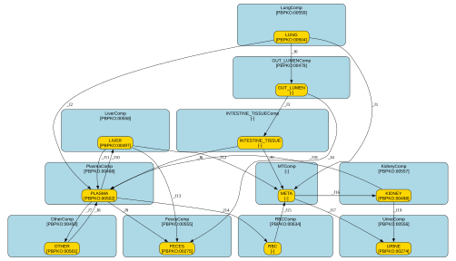

# Cadmium PBK model 

This repository contains a revised, FAIR reimplementation of the cadmium PBK model developed by [Gastellu et al. (2026)](https://doi.org/10.1016/j.fct.2024.115111), which was itself based on the model originally developed by [Kjellström and Nordberg (1978)](https://doi.org/10.1016/0013-9351(78)90160-3).

Compared with the model from Gastellu et al., the present implementation includes two distinct types of changes. The first concerns model revisions, involving changes to the model formulation itself. The second concerns the FAIR reimplementation, involving changes required to encode the model in Antimony/SBML in accordance with the [FAIR PBK standard](https://doi.org/10.1016/j.comtox.2026.100426). The resulting SBML (FAIR) representation of the model is provided in [pbk_cd_gastellu_2026_revised.sbml](model/pbk_cd_gastellu_2026_revised.sbml). A diagram of the model compartments and species is shown below.




## Model revision

Key changes in the revised model are:

- **Simplification of tissue volumes and body-weight calculations:** Instead of explicitly calculating volumes for numerous organs and tissues, the revised model retains the principal compartments (blood, kidney, liver, lungs, intestine) and calculates the remaining tissue volume as the difference from total body weight. This also changes how `wbw_f` is determined.
- **Addition of age range guard:** The revised implementation guards selected age-dependent equations at their upper age ranges.
- **Restructuring of gastrointestinal absorption:** The original single `GUT` compartment is replaced by two sequential compartments (`GUT` and `INTESTINE`) according to Kjellström and Nordberg (1978) and Pouillot et al. (2022). The revised equations explicitly distinguish gastrointestinal input, transit, absorption, and add the nonabsorbed fraction eliminated in feces.
- **Removal of the intermediate systemic uptake compartment:** The original dynamic `UPTAKE1` compartment is replaced by the algebraic variable `uptakeTotal`, calculated directly from pulmonary and intestinal absorption. Cadmium uptake is subsequently divided into metallothionein-associated uptake (`uptakeMT`) and plasma uptake (`uptakePlasma`), retaining the saturable allocation mechanism.
- **Replace hard cap in calculation of metallothionein-associated uptake by smooth approximation:** The hard cap of `min(k7 * uptakeTotal, k8)` for metallothionein-associated uptake (`uptakeMT`) was replaced with a smooth approximation around `k8` to improve numerical stability. It is close to, but not mathematically identical to, the piecewise cap used in R.
- **Revision of metallothionein-associated kinetics:** A new rate constant, `k_MT_out`, is introduced to explicitly scale cadmium transfer from the metallothionein compartment to the kidney and urinary elimination pathways, thereby achieving unit consistency. `K_MT_out` was set as 1, so that it does not influence the simulation.
- **Addition of cadmium redistribution from the kidney to the plasma:** The revised plasma equation includes `+ k18 * KIDNEY`, representing transfer from the kidney back to the circulating compartment. In the original model, this term was absent from the plasma equation, despite being included as a kidney loss.
- **Revised treatment of prenatal cadmium exposure:** The original time-dependent `CORD_quant` exposure input is removed. The current Antimony model does not set a prenatal cadmium burden: `PLASMA` and `RBC` both start at zero. Prenatal burden would need to be supplied separately through initial conditions.
- **Revised calculation of blood cadmium concentrations:** The revised model distinguishes total blood-associated cadmium amount (`BLOOD`) from blood cadmium concentration (`BLOOD_burden` in the R implementation and `CBLOOD` in Antimony), avoiding the previous use of `BLOOD` as a concentration.
- **Improved representation of elimination pathways and mass balance:** The revised model explicitly includes gastrointestinal elimination of nonabsorbed cadmium and cumulative fecal and urinary excretion. The revised R implementation also includes a cumulative exhalation compartment (`EXH`) and distinguishes cadmium retained in the body (`total`) from cumulative eliminated cadmium (`Excreted`); these aggregate outputs are not included in the current Antimony model.
- **Removal of source–route-specific tracking from the revised implementation:** Source-specific contributions cannot be directly extracted from the revised model without additional calculations or simulations.

## Revised R model implementation

The file [pbk_cd_gastellu_2026_revised.R](validation/R/pbk_cd_gastellu_2026_revised/pbk_cd_gastellu_2026_revised.R) contains the revised R implementation. Changes specific to the revised R implementation are:

- **Separation of physiological calculations from the PBK model:** Age- and sex-dependent physiological equations have been moved into a separate `phys()` R function. This simplifies the PBK ODE system and facilitates independent updates of physiological parameters.
- **Revised implementation of time-dependent exposure:** Separate release-rate constants have been introduced for ingestion (`king_release`), inhalation (`kinh_release`), and dermal exposure (`kderm_release`). This allows different temporal patterns of exposure delivery.
- **Introduction of route-specific availability factors:** The revised model introduces `f_ing_available`, `f_inh_available`, and `f_derm_available` to capture the fraction of exposure available via each route.

## SBML/Antimony model implementation

The file [pbk_cd_gastellu_2026_revised.ant](model/pbk_cd_gastellu_2026_revised.ant) contains the Antimony implementation of the model. Conversion to the annotated SBML file is done through the script [create_sbml.py](scripts/create_sbml.py). This script first converts the Antimony model implementation to SBML and then annotates this SBML file using the annotations specified in the [pbk_cd_gastellu_2026_revised.annotations.csv](model/pbk_cd_gastellu_2026_revised.annotations.csv) file.

The following changes were made to the Antimony/SBML reimplementation for compliance with the FAIR PBK standard:

- **Explicit density parameter:** For consistency of units, an additional density parameter `rho_body` is included for translating mass to volume.
- **Explicit age at simulation start:** `AgeInit` specifies the individual's age at the start of a simulation in years. Current age (`Age`) is calculated as `AgeInit + time / 365`, with simulation time in days, and is used throughout the model's age-dependent physiology and kinetics.
- **Exclusion of exposure/dosing parameters:** In compliance with the standard, dosing is excluded from the Antimony/SBML model. Accordingly, exposure sources and their associated reactions are not represented in the reimplementation.
- **Removal of prenatal initialization:** The cord-blood initialization parameters and calculations have been removed. `PLASMA` and `RBC` are initialized to zero.
- **Reduction of derived outputs:** The Antimony model retains `BLOOD` (amount), `CBLOOD` (whole-blood concentration), and `ucdcr` (urinary concentration expressed in creatinine), but does not define derived outputs for the kidney burden, concentration in urine, total body burden and total amount excreted. These outputs can be calculated during post-processing from the existing model variables. Keeping them outside the core model helps to maintain simplicity and computational efficiency during simulations.

## Implementation comparison

This table summarizes the changes from the Gastellu et al. model to the revised PARC R model, and notes how those changes are represented in the SBML implementation. It is a structural comparison; entries marked as different or partial should not be taken to imply that the implementations are numerically equivalent.

| No. | Component | Original model (Gastellu et al.) | Revised R implementation | R-model rationale or notes | SBML representation | R–SBML differences |
|---:|---|---|---|---|---|---|
| 1 | Model organization | Physiology and ODEs are combined in `rxode2()`. | Physiology is in a separate `phys()` function; ODEs remain in `rxode2()`. | Improves readability. | Yes; different structure. | R separates `phys()`; SBML embeds physiology as assignment rules. |
| 2 | Model organization | Parameters are defined in the same R script as the ODEs. | Parameters are held in a separate list from the ODEs. | Improves readability and makes parameter values easier to adjust. | Yes. | - |
| 3 | Annotation | - | Parameter names were modified and descriptions added. | Improves readability and makes parameters easier to follow. | According to FAIR PBK standard. | - |
| 4 | Physiological compartments | Detailed tissue and organ calculations. | Major organs plus residual `vother`. | Omits volume calculations for compartments not represented in the PBK model. | Yes. | Both simplify tissues; compare definitions before assuming the calculations are identical. |
| 5 | Body weight | `wbw_f` is calculated from the sum of individual tissue volumes. | The notes describe `wbw_f` as equal to `wbw` using residual `vother`. | The source notes also say `wbw_f` was removed from the revised model; confirm the variable definition and formula. | Yes. | Both are described as using residual `vother` and `wbw_f`; verify that the formulas are equivalent. |
| 6 | Exposure release kinetics | Exposure compartments decay at `1/day`. | Uses `king_release`, `kinh_release`, and `kderm_release`. | Added for unit consistency. These parameters are all set to 1, so they do not affect the outcome. | No. | External exposure factors are excluded from the SBML PBK model. |
| 7 | Exposure availability | No explicit route-specific availability fractions. | Uses `f_ing_available`, `f_inh_available`, and `f_derm_available`. | Added to make route contributions adjustable. The ingestion and inhalation fractions are set to 1; the dermal fraction can be varied. | No. | External exposure factors are excluded from the SBML PBK model. |
| 8 | GI structure | One `GUT` compartment. | Sequential `GUT` and `INTESTINE` compartments. | Follows Kjellström and Nordberg (1978) and Pouillot et al. (2022). | Yes. | - |
| 9 | GI absorption | `k5` multiplies GI input before `GUT`. | `k5` multiplies transfer from `GUT` to `INTESTINE`. | Follows Kjellström and Nordberg (1978) and Pouillot et al. (2022). | Yes. | - |
| 10 | Unabsorbed fraction | No explicit `(1-k5)` fecal flux. | Adds `(1-k5) * kabs * GUT` to `FECES`. | Supports accurate mass-balance calculations, following Pouillot et al. (2022). | Yes. | - |
| 11 | Systemic uptake | Dynamic `UPTAKE1` compartment. | Algebraic `uptakeTotal` flux. | - | Yes; different structure. | SBML represents uptake through reactions. |
| 12 | Uptake allocation | `UPTAKE2` and `UPTAKE3` are based on `UPTAKE1`. | `uptakeMT` and `uptakePlasma` are based on `uptakeTotal`. | Uses a smooth-function translation. | Yes. | - |
| 13 | Metallothionein transfer | `k17x * META` and `k17b * META`. | `k_MT_out * k17x * META` and `k_MT_out * k17b * META`. | Added `k_MT_out` for unit consistency. | Yes. | - |
| 14 | Kidney to plasma | `-k18 * KIDNEY` in kidney, with no corresponding plasma input. | Adds `+k18 * KIDNEY` to plasma. | Corrects a missing plasma input. | Yes. | - |
| 15 | Dermal absorption | Fixed 0.5% contribution. | `f_derm_available * kderm_release * exposure`. | The 0.5% contribution can be adjusted externally through `f_derm_available`. | No. | External exposure factors are excluded from the SBML PBK model. |
| 16 | Prenatal exposure | Decaying `CORD_quant` state and blood inputs. | Removes the `CORD_quant` ODE; intended to use initial conditions. | Initial cord-blood concentration can be used to calculate initial amounts in plasma and RBCs. | No prenatal initialization; `PLASMA` and `RBC` start at zero. | The Antimony model does not initialize a prenatal burden. |
| 17 | Blood cadmium | `BLOOD` is concentration divided by `vb`. | `BLOOD` is amount; `BLOOD_burden` is concentration. | Corrects the calculation of blood amount and concentration, which is important for mass balance and validation. | Yes: `BLOOD` is amount and `CBLOOD` is concentration. | Antimony names the concentration `CBLOOD` rather than `BLOOD_burden`. |
| 18 | Fecal elimination | `k11 * PLASMA + k15 * LIVER`. | Adds `(1-k5) * kabs * GUT`. | Supports accurate mass-balance calculations, following Pouillot et al. (2022). | Yes. | - |
| 19 | Urinary elimination | `k17b * META + k19x * KIDNEY`. | `k_MT_out * k17b * META + k19x * KIDNEY`. | Added `k_MT_out` for unit consistency. | Yes. | - |
| 20 | Exhalation | No cumulative `EXH` compartment. | `EXH` tracks unretained inhaled cadmium. | Supports accurate mass-balance calculations, following Pouillot et al. (2022). | No. | `EXH` depends on external exposure factors and is therefore excluded from the PBK model. |
| 21 | Body burden | `wb` and total use different definitions. | Total sums retained compartments, including `INTESTINE`. | Updated to reflect the compartments in the revised model. | No aggregate body-burden output; compartment amounts remain available. | The revised R model defines total explicitly; Antimony does not define `total_internal` or an equivalent aggregate. |
| 22 | Cumulative excretion | `FECES` and `URINE`. | `Excreted = FECES + URINE + EXH`. | Supports accurate mass-balance calculations, following Pouillot et al. (2022). | Partial: includes `FECES` and `URINE` states. | Antimony has no `EXH` compartment or `Excreted` aggregate; the revised R `Excreted` includes all three. |
| 23 | Source-route attribution | Separate PBK2 source-route model. | Revised file contains combined `pbk_cd` only. | Route tracking could be added once the revised model is agreed upon. | No; route tracking is absent. | Neither revised implementation retains the original PBK2 source-resolved states. |
| 24 | Sex-specific GI parameter | Sex-dependent `k5` in the original physiology. | `k5` is selected through `k5_h` or `k5_f` in `phys()`. | - | Yes. | - |

**SBML representation key:** "Yes" means represented in the SBML model; "No" means omitted; "Partial" means only part of the feature is represented.

## Validation

The SBML implementation is validated against an R implementation of the original model ([pbk_cd_gastellu_2026.R](validation/R/pbk_cd_gastellu_2026/pbk_cd_gastellu_2026.R)) and an R implementation of the revised model ([pbk_cd_gastellu_2026_revised.R](validation/R/pbk_cd_gastellu_2026_revised/pbk_cd_gastellu_2026_revised.R)). The validation scenarios include a single-dose, repeated-dose, and two lifetime-dosing scenarios. Scenario definitions, reference scripts, run instructions, and output details are documented in the [validation README](validation/README.md).

## Running the scipts

### Prerequisites

To run scripts you will need Python installed on your system, along with several additional packages. You can install these packages using the following command:

```
pip install -r requirements.txt
```

### Compile model

To convert the Antimony model implementation to SBML and annotates it, type:

```
python ./scripts/compile_model.py
```

### Create model docs

To create the [model documentation page](docs/pbk_cd_gastellu_2026_revised.report.md), type:

```
python ./scripts/create_report.py
```

### Run validation scenarios

To run the run simulation scenarios, type:

```
python ./scripts/run_validation.py
```

By default, this script reuses existing outputs from previous runs. To override and recalculate outputs that already exist, use the `-f` option.

To run the run simulation scenarios for a specific scenario config (e.g. thos defined in [validation/scenarios/R.yaml](validation/scenarios/R.yaml)), type:

```
python ./scripts/run_validation.py -c validation/scenarios/R.yaml
```
